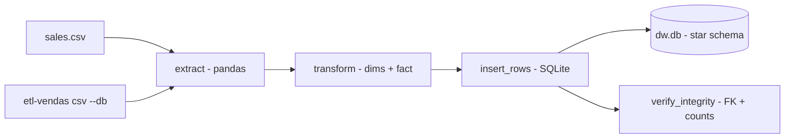

# etl-vendas-datawarehouse

**English** · [Português (Brasil)](README.md)

[](#) [](#) [](#) [](LICENSE)

## What it is

**A sales ETL pipeline for a data warehouse**: it extracts a **sales CSV**, transforms it into a **star schema** (dim_tempo, dim_cliente, dim_produto + fato_vendas), loads it into **SQLite** and **verifies integrity** (foreign keys, row counts). It is an educational dimensional-modelling/ETL lab.

## Status

An educational lab, working and tested (6 tests).

## Features

- **Extract** (`etl.py`): `extract(csv_path)` — reads the sales CSV into a pandas DataFrame.
- **Transform**: builds the `dim_tempo`, `dim_cliente`, `dim_produto` dimensions and the `fato_vendas` fact table from the raw data.
- **Load** (`db.py`): `connect`, `create_schema`, `clear_tables`, `insert_rows` — loads into SQLite.
- **Load quality** (`verify_integrity`): `foreign_key_check` + per-table counts; `ETLResult` summarises rows read/written.
- **CLI**: `etl-vendas <csv> [--db path]`.

## Architecture

An `etl_vendas_datawarehouse` package with `etl.py` (extract/transform), `db.py` (schema/load/integrity) and `cli.py`. Output: a SQLite file with the star schema.



## Stack

- Python ≥ 3.10
- pandas ≥ 2.2 (only dependency; SQLite via stdlib)
- pytest (dev)

## Repository layout

```
etl-vendas-datawarehouse/
├── pyproject.toml · BRIEF.md
├── src/etl_vendas_datawarehouse/
│   ├── etl.py   # extract/transform (star schema)
│   ├── db.py    # schema/load/verification
│   └── cli.py   # CLI
├── tests/       # 6 tests
└── LICENSE      # MIT
```

## Prerequisites and installation

```bash
pip install -e .
```

## How to run

```bash
etl-vendas sales.csv --db dw.db
```

## Tests and quality

Real command (verified by the agent):

```bash
PYTHONPATH=src python -m pytest tests/
# 6 passed
```

## Technical decisions and trade-offs

- **A classic star schema** (3 dimensions + fact): didactic, direct dimensional modelling.
- **SQLite as the target**: zero setup; the trade-off is that it does not scale to real volumetric loads.
- **Built-in integrity verification**: FK check and counts run as part of the load.

## Known limitations and roadmap

- No incremental load (it clears and reloads the tables on each run).
- The input CSV must have the fields the transform expects (no advanced schema validation).

## Development process

An individual project by Kelvin Oliveira, built with orchestrated AI agents and reviewed by the author.

## License and author

MIT — Copyright (c) 2026 Kelvin Rebelo de Oliveira. Author: [Kelvin Oliveira](https://github.com/KelvinOliveiraCode) · [Portfolio](https://kelvinoliveiracode.github.io/portfolio/)
