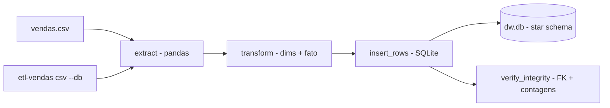

# etl-vendas-datawarehouse

[English](README.en.md) · **Português (Brasil)**

[](#) [](#) [](#) [](LICENSE)

## O que é

**Pipeline ETL de vendas para data warehouse**: extrai um **CSV de vendas**, transforma em **star schema** (dim_tempo, dim_cliente, dim_produto + fato_vendas), carrega em **SQLite** e **verifica a integridade** do resultado (chaves estrangeiras, contagens). É um laboratório educacional de modelagem dimensional/ETL.

## Status

Laboratório educacional funcional e testado (6 testes).

## Funcionalidades

- **Extract** (`etl.py`): `extract(csv_path)` — lê o CSV de vendas num DataFrame pandas.
- **Transform**: constrói as dimensões `dim_tempo`, `dim_cliente`, `dim_produto` e a tabela `fato_vendas` a partir dos dados brutos.
- **Load** (`db.py`): `connect`, `create_schema`, `clear_tables`, `insert_rows` — carrega no SQLite.
- **Qualidade de carga** (`verify_integrity`): `foreign_key_check` + contagens por tabela; `ETLResult` resume linhas lidas/gravadas.
- **CLI**: `etl-vendas <csv> [--db caminho]`.

## Arquitetura

Pacote `etl_vendas_datawarehouse` com `etl.py` (extract/transform), `db.py` (schema/load/integridade) e `cli.py`. Saída: um arquivo SQLite com o star schema.



## Stack

- Python ≥ 3.10
- pandas ≥ 2.2 (única dependência; SQLite via stdlib)
- pytest (dev)

## Estrutura do repositório

```
etl-vendas-datawarehouse/
├── pyproject.toml · BRIEF.md
├── src/etl_vendas_datawarehouse/
│   ├── etl.py   # extract/transform (star schema)
│   ├── db.py    # schema/load/verificação
│   └── cli.py   # CLI
├── tests/       # 6 testes
└── LICENSE      # MIT
```

## Pré-requisitos e instalação

```bash
pip install -e .
```

## Como executar

```bash
etl-vendas vendas.csv --db dw.db
```

## Testes e qualidade

Comando real (verificado pelo agente):

```bash
PYTHONPATH=src python -m pytest tests/
# 6 passed
```

## Decisões técnicas e trade-offs

- **Star schema clássico** (3 dimensões + fato): modelagem dimensional didática e direta.
- **SQLite como alvo**: zero setup; em troca, não escala para cargas volumétricas de verdade.
- **Verificação de integridade embutida**: FK check e contagens rodam na própria carga.

## Limitações conhecidas e roadmap

- Sem carga incremental (limpa e recarrega as tabelas a cada execução).
- O CSV de entrada precisa dos campos esperados pelo transform (sem validação de schema avançada).

## Processo de desenvolvimento

Projeto individual de Kelvin Oliveira, construído com agentes de IA orquestrados e revisado pelo autor.

## Licença e autor

MIT — Copyright (c) 2026 Kelvin Rebelo de Oliveira. Autor: [Kelvin Oliveira](https://github.com/KelvinOliveiraCode) · [Portfólio](https://kelvinoliveiracode.github.io/portfolio/)
